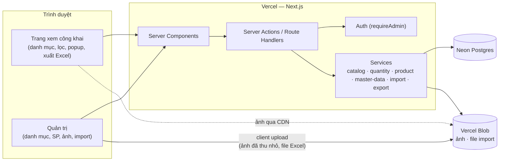
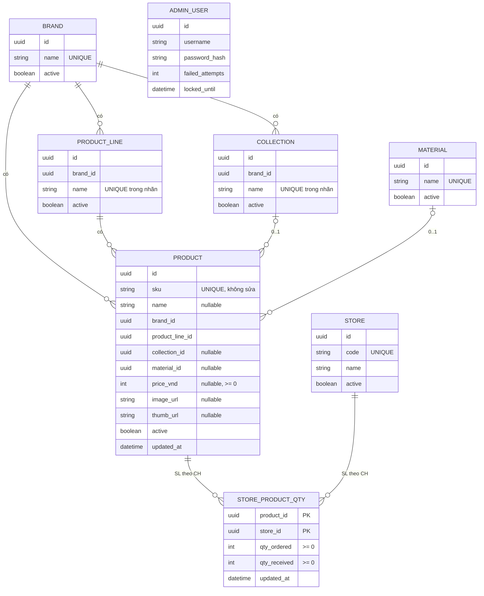
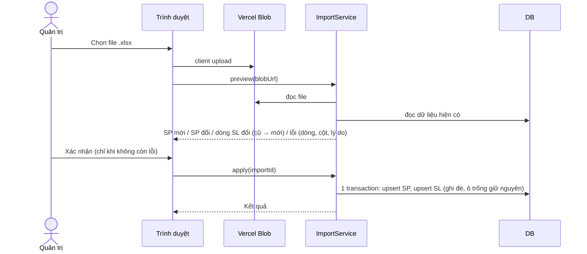

# ARCHITECTURE — Website Bộ Sưu Tập Trang Sức Xuân Thần Tài

> Trạng thái: **ĐÃ CHỐT** (2026-10-30) — các quyết định ở [docs/decisions/](docs/decisions/).

---

## 1. Nguyên tắc thiết kế
1. **Một ứng dụng** (Next.js) cho cả trang xem công khai và khu vực quản trị.
2. **Logic nghiệp vụ ở service layer** — công thức còn thiếu/tỷ lệ, ràng buộc cùng nhãn, quy tắc import chỉ nằm một chỗ, dùng chung cho UI, import và export.
3. **Responsive cho cả điện thoại và máy tính** (Q-19).
4. **Nhập dữ liệu an toàn**: xem trước → xác nhận → ghi trong transaction.
5. **Phù hợp Vercel serverless**: file lớn tải thẳng từ trình duyệt lên Blob, ảnh thu nhỏ trên trình duyệt (ADR-005).

---

## 2. Stack (ADR-001, ADR-005)
| Lớp | Công nghệ |
|-----|-----------|
| Frontend + Backend | **Next.js (App Router) + TypeScript**, Server Components + Server Actions |
| UI | Tailwind CSS (design tokens từ [UI-DESIGN §2](docs/UI-DESIGN.md)) + shadcn/ui; font Playfair Display + Be Vietnam Pro qua `next/font` |
| ORM | Prisma |
| CSDL | **Neon Postgres** (dev cục bộ: Docker Postgres) |
| Lưu ảnh & file import | **Vercel Blob** (client upload) |
| Xử lý ảnh | Thu nhỏ trên trình duyệt (canvas → WEBP: ~1600px + thumbnail ~400px) |
| Giải nén zip ảnh | JSZip trên trình duyệt |
| Đọc / ghi Excel | ExcelJS (server: đọc file import, tạo mẫu, xuất dữ liệu) |
| Xác thực | Auth.js Credentials — 1 tài khoản quản trị |
| Validation | Zod (dùng chung form + import) |
| Kiểm thử | Vitest (unit/integration), Playwright (E2E, viewport mobile + desktop) |
| Triển khai | Vercel (Hobby khi thử → **Pro trước go-live**); CI GitHub Actions |

---

## 3. Sơ đồ thành phần



---

## 4. Mô hình dữ liệu



### 4.1 Ràng buộc
| Ràng buộc | Nơi kiểm tra |
|-----------|--------------|
| `sku`, `store.code`, tên nhãn, tên chất liệu duy nhất | CSDL |
| Tên dòng / BST duy nhất trong nhãn | CSDL (unique `brand_id, name`) |
| Dòng và BST cùng nhãn với SP | Service + import |
| SL, giá ≥ 0 | Zod + CHECK |
| Không sửa `sku` | Service (không có trường sửa) |
| Không đổi nhãn của dòng/BST đã có SP | Service |

### 4.2 SP "hiển thị được" (visible)
```
product.active AND brand.active AND line.active
AND (collection_id IS NULL OR collection.active)
AND (material_id IS NULL OR material.active)
```
Ẩn nhãn/dòng/BST/chất liệu → SP ẩn theo, không thay đổi `product.active` (ADR-008 M2). Cửa hàng bị ẩn → không có trong bộ lọc, chi tiết và **không cộng vào tổng** *(mặc định kỹ thuật)*.

### 4.3 Số liệu tính toán (ADR-007)
```
Theo CH:   thiếu = max(đặt − về, 0)        tỷ lệ = đặt = 0 ? null : min(về / đặt, 1)
Tổng:      Đ = Σđặt, V = Σvề (CH active)   thiếu = max(Đ − V, 0)   tỷ lệ = Đ = 0 ? null : min(V / Đ, 1)
```
Tính bằng SQL (CTE/view `product_totals`) để lọc, đếm, sắp xếp "còn thiếu nhiều nhất" ngay trong truy vấn. Quy mô vừa (≤ 3.000 SP × ≤ 100 CH ≈ 300.000 dòng SL) xử lý tốt với chỉ mục `(store_id, product_id)` và `(product_id)`.

---

## 5. Luồng chính

### 5.1 Xem, lọc, tìm, sắp xếp
Tham số URL: `?brand=a,b&line=…&col=…,none&mat=…&store=CH01&all=1&q=NTT&sort=sku|updated|price_asc|price_desc|shortage&view=grid|list&sp=NTT001`

1. Server đọc tham số → `catalog.listProducts()` lọc SP visible; trong một chiều dùng OR, giữa các chiều dùng AND; `col=none` = không thuộc BST.
2. Không có `store` → số tổng; có `store` → số của CH đó, mặc định chỉ SP có đặt > 0, `all=1` hiện tất cả.
3. `catalog.getFacetCounts()` đếm SP cho từng lựa chọn của mỗi bộ lọc (tính với các bộ lọc **khác** đang áp dụng).
4. `sp=MA` mở popup chi tiết (`catalog.getProductDetail`).

### 5.2 Nhập Excel


### 5.3 Tải ảnh hàng loạt
Chọn nhiều file / thư mục / .zip → giải nén & đọc tên trên trình duyệt → đối chiếu mã SP với server → xem trước (khớp / không khớp / SP chưa có ảnh) → xác nhận → thu nhỏ 2 kích thước → client upload lên Blob → server ghi `image_url`, `thumb_url` (ảnh cũ bị thay và xóa khỏi Blob).

### 5.4 Xuất Excel (F11)
- Người xem: `GET /api/export?<cùng tham số lọc>` → file .xlsx danh sách đang lọc.
- Quản trị: `/admin/export` → file đúng mẫu nhập (2 sheet), nhập lại được ngay.

---

## 6. Cấu trúc thư mục

```
xuan-than-tai/
├─ PROJECT.md · ARCHITECTURE.md · TASKS.md
├─ features/                       # F01–F11
├─ docs/
│  ├─ decisions/                   # ADR-001 … ADR-009
│  ├─ UI-DESIGN.md                 # đặc tả giao diện
│  ├─ brand/                       # logo công ty
│  ├─ mockups/                     # mockup HTML tĩnh (T00)
│  └─ user-guide.md
├─ prisma/
│  ├─ schema.prisma
│  ├─ migrations/
│  └─ seed.ts
├─ scripts/
│  └─ set-admin-password.ts
├─ src/
│  ├─ app/
│  │  ├─ (public)/
│  │  │  └─ page.tsx               # danh mục + bộ lọc + popup (?sp=)
│  │  ├─ (admin)/admin/
│  │  │  ├─ master-data/           # Nhãn / Dòng / BST / Chất liệu / Cửa hàng
│  │  │  ├─ products/
│  │  │  ├─ images/                # tải ảnh hàng loạt
│  │  │  ├─ import/                # nhập Excel + tải mẫu
│  │  │  ├─ quantities/            # sửa nhanh SL
│  │  │  ├─ export/
│  │  │  └─ account/
│  │  ├─ login/
│  │  ├─ api/
│  │  │  ├─ export/route.ts
│  │  │  ├─ blob-upload/route.ts   # cấp token client upload (chỉ admin)
│  │  │  └─ health/route.ts
│  │  └─ robots.ts                 # Disallow all
│  ├─ components/{catalog,admin,ui}/
│  ├─ server/
│  │  ├─ services/                 # catalog, quantity, product, master-data, import, export
│  │  ├─ repositories/
│  │  ├─ auth/
│  │  └─ storage/                  # adapter Vercel Blob
│  ├─ lib/
│  │  ├─ validation/               # Zod
│  │  ├─ metrics.ts                # công thức thiếu / tỷ lệ (dùng chung)
│  │  ├─ excel-template.ts         # định nghĩa cột mẫu (dùng chung import/export)
│  │  └─ image-resize.ts           # thu nhỏ ảnh phía trình duyệt
│  └─ types/
├─ tests/{unit,integration,e2e}/
├─ .env.example
├─ docker-compose.yml              # Postgres cho dev
└─ package.json
```

---

## 7. Yêu cầu phi chức năng
| Hạng mục | Mục tiêu |
|----------|----------|
| Hiệu năng | Danh mục tải ≤ 3s trên 4G; lọc/sắp xếp ≤ 1s với 3.000 SP × 100 CH |
| Import | File 3.000 SP + 100.000 dòng SL: xem trước ≤ 30s; áp dụng hoàn tất trong giới hạn function của gói Pro |
| Responsive | Dùng tốt từ 360px đến desktop; test cả hai |
| Bảo mật | HTTPS; `/admin/*` và mọi thao tác ghi yêu cầu đăng nhập kiểm tra ở server; token upload Blob chỉ cấp cho admin; `noindex` |
| Sao lưu | Neon PITR + dump hằng ngày (GitHub Action) giữ 7 bản |
| Trình duyệt | Chrome/Edge/Safari 2 phiên bản gần nhất |

---

## 8. Rủi ro kỹ thuật
| Rủi ro | Giảm thiểu |
|--------|-----------|
| Import lớn vượt thời gian function | Đọc file 1 lần, ghi theo lô `createMany`/`upsert` trong transaction; đo ở T08.10; dùng gói Pro cho production |
| Gõ sai tên danh mục / mã cửa hàng trong Excel | Mẫu có danh sách chọn (data validation); import báo lỗi rõ dòng/cột |
| Tên file ảnh không khớp mã | Bước xem trước liệt kê ảnh không khớp & SP chưa có ảnh |
| Ảnh lớn làm chậm trang | Thu nhỏ trên trình duyệt; danh mục dùng thumbnail; lazy-load |
| Trang xem công khai | Rủi ro đã chấp nhận (ADR-004); `noindex` |
| Quên mật khẩu quản trị duy nhất | Script đặt lại mật khẩu (chạy với biến môi trường DB) |
| Quên nâng Vercel Pro trước go-live | Mục bắt buộc trong checklist T10.10 |

---

## 9. ADR
| ADR | Nội dung | Trạng thái |
|-----|----------|-----------|
| [001](docs/decisions/ADR-001-architecture.md) | Phương án kiến trúc | ✅ |
| [002](docs/decisions/ADR-002-quantity-model.md) | Mô hình số lượng | ✅ |
| [003](docs/decisions/ADR-003-classification.md) | Phân loại & mã SP | ✅ |
| [004](docs/decisions/ADR-004-auth.md) | Truy cập & phân quyền | ✅ |
| [005](docs/decisions/ADR-005-infrastructure.md) | Hạ tầng Vercel | ✅ |
| [006](docs/decisions/ADR-006-import-and-images.md) | Mẫu Excel & tải ảnh | ✅ |
| [007](docs/decisions/ADR-007-display-filter-sort.md) | Hiển thị, lọc, sắp xếp, xuất | ✅ |
| [008](docs/decisions/ADR-008-product-data-rules.md) | Quy tắc dữ liệu & phạm vi | ✅ |
| [009](docs/decisions/ADR-009-ui-design.md) | Giao diện & nhận diện | ✅ |
