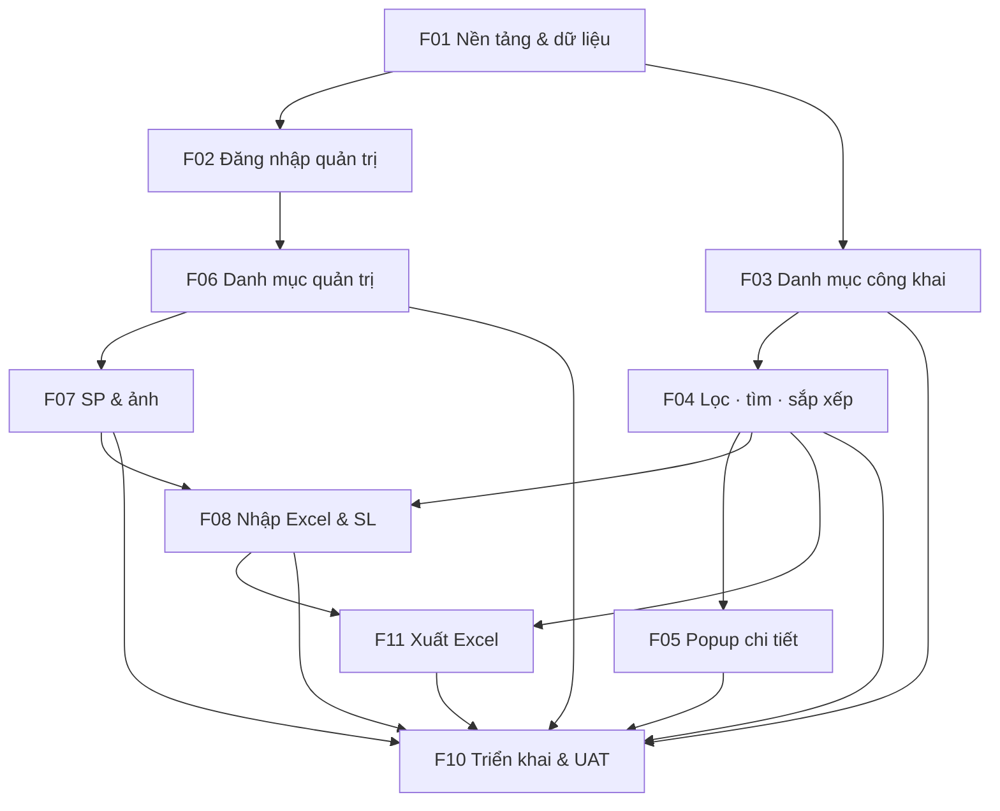
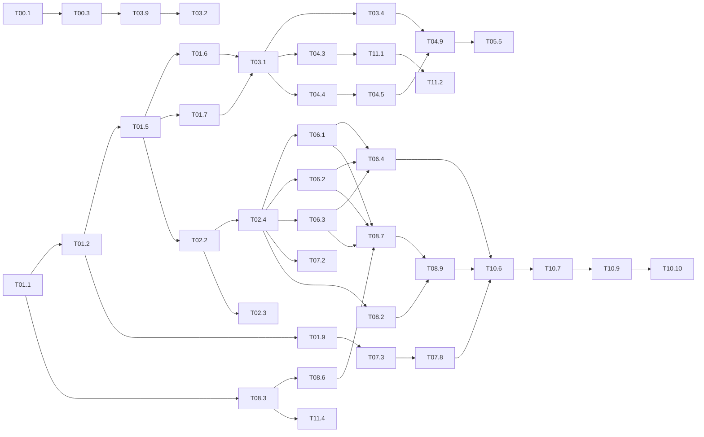

# TASKS — Danh sách công việc & Phụ thuộc

> Trạng thái: **PLANNING HOÀN TẤT** — mọi câu hỏi đã được trả lời (2026-10-30). Không còn task bị chặn.
> Chi tiết cách kiểm thử từng task: file feature tương ứng ở [features/](features/).
> Ký hiệu: ⬜ Chưa làm · 🟨 Đang làm · ✅ Xong · ✂️ Bỏ
> Kích thước: **S** ≤ 0,5 ngày · **M** 1–2 ngày · **L** 3–5 ngày

---

## 0. Cổng quyết định — tất cả đã mở

| Gate | Câu hỏi | Trạng thái |
|------|---------|-----------|
| G-DATA | Q-01, 02, 04, 09, 10, 16 | ✅ ADR-002, 003, 008 |
| G-AUTH | Q-05, 06, 26 | ✅ ADR-004, 005 |
| G-QTY | Q-07, 08, 22, 25, 27, R5, R6 | ✅ ADR-002, 006, 008 |
| G-FILTER | Q-14, 24, B1–B9 | ✅ ADR-007 |
| G-UI | Q-03, 13, 15, 18, 19, sắp xếp, màu sắc, bố cục, font | ✅ ADR-007, ADR-009 (mockup duyệt ở T00.3) |
| G-INFRA | Q-12, 20, 21 | ✅ ADR-005 |
| G-AUDIT | Q-17 | ✅ Bỏ F09 |

**Việc của chủ dự án:** đặt logo vào `docs/brand/` (trước T00.1); duyệt mockup (T00.3); tạo tài khoản Vercel (trước T10.2); nâng Vercel Pro và chọn tên miền (trước T10.10).

---

## 1. Danh sách task

### F00 — Mockup giao diện ([UI-DESIGN](docs/UI-DESIGN.md), ADR-009)
| ID | Task | Phụ thuộc | Size | TT |
|----|------|-----------|------|----|
| T00.1 | Mockup HTML tĩnh trang xem: Lưới, Bảng, cột lọc / ngăn kéo, popup — máy tính + điện thoại ([link](https://claude.ai/artifact/QxGARukK9ciCcZ9PHuUXwG)) | Logo trong `docs/brand/` (đang dùng ô tạm) | M | ✅ |
| T00.2 | Mockup quản trị: màn hình xem trước nhập Excel | T00.1 | S | ✅ |
| T00.3 | Chủ dự án duyệt mockup — ✅ **đã duyệt 2026-10-30** (bản cuối: banner tranh Tết `docs/brand/tet-banner.png`, thanh "Cửa hàng của bạn" dính) | T00.1, T00.2 | S | ✅ |

### F01 — Nền tảng & dữ liệu ([chi tiết](features/F01-foundation-data-model.md))
| ID | Task | Phụ thuộc | Size | TT |
|----|------|-----------|------|----|
| T01.1 | Khởi tạo dự án, lint, Tailwind, shadcn/ui | — | S | ✅ |
| T01.2 | docker-compose Postgres, `.env.example` | T01.1 | S | ✅ |
| T01.3 | Vitest + Playwright (mobile + desktop) | T01.1 | S | ✅ |
| T01.4 | Chốt mô hình dữ liệu | — | S | ✅ |
| T01.5 | Prisma schema + migration | T01.2 | M | ✅ |
| T01.6 | Repository + "SP visible" + ràng buộc cùng nhãn | T01.5 | M | ✅ |
| T01.7 | `metrics.ts` + `product_totals` | T01.5 | S | ✅ |
| T01.8 | Seed dữ liệu mẫu | T01.5 | S | ✅ |
| T01.9 | Adapter Vercel Blob (test upload/xóa thật qua, store Public, 2026-11-02) | T01.2 | S | ✅ |
| T01.10 | CI GitHub Actions (CI xanh trên main, 2026-11-02) | T01.3 | S | ✅ |
| T01.11 | Seed quy mô lớn | T01.8 | S | ✅ |

### F02 — Đăng nhập quản trị ([chi tiết](features/F02-auth-permissions.md))
| ID | Task | Phụ thuộc | Size | TT |
|----|------|-----------|------|----|
| T02.1 | Chốt xác thực | — | S | ✅ |
| T02.2 | Auth.js Credentials + `/login` | T01.5 | M | ✅ |
| T02.3 | Middleware `/admin/*` | T02.2 | S | ✅ |
| T02.4 | `requireAdmin()` | T02.2 | S | ✅ |
| T02.5 | Script đặt mật khẩu | T02.2 | S | ✅ |
| T02.6 | Trang đổi mật khẩu | T02.4 | S | ✅ |
| T02.7 | Tạm khóa khi sai nhiều lần | T02.2 | S | ✅ |
| T02.8 | robots + noindex | T01.1 | S | ✅ |

### F03 — Danh mục công khai ([chi tiết](features/F03-product-catalog.md))
| ID | Task | Phụ thuộc | Size | TT |
|----|------|-----------|------|----|
| T03.1 | `listProducts` + số liệu theo phạm vi | T01.6, T01.7 | M | ✅ |
| T03.2 | `ProductCard` | T03.9 | S | ✅ |
| T03.3 | `ProductGrid` responsive | T03.2 | S | ✅ |
| T03.4 | Trang `/` | T03.1, T03.3 | S | ✅ |
| T03.5 | Phân trang / tải thêm | T03.4 | S | ✅ |
| T03.6 | Rỗng / lỗi / loading | T03.4 | S | ✅ |
| T03.7 | Ảnh thumbnail, lazy-load | T03.2 | S | ✅ |
| T03.8 | Nhãn phạm vi số liệu | T03.2, T04.5 | S | ✅ |
| T03.9 | Design tokens, font, header | T01.1, T00.3 | S | ✅ |
| T03.10 | Nhãn trạng thái (4 trạng thái) | T01.7 | S | ✅ |
| T03.11 | Dạng Bảng + chuyển Lưới/Bảng | T03.4, T03.10 | M | ✅ |
| T03.12 | Banner Tết + thanh dính | T03.9, T04.2 | M | ✅ |
| T03.13 | Khu Bộ sưu tập | T03.1, T04.9 | M | ✅ |
| T03.14 | Chân trang | T03.9 | S | ✅ |

### F04 — Lọc, tìm, sắp xếp ([chi tiết](features/F04-filters.md))
| ID | Task | Phụ thuộc | Size | TT |
|----|------|-----------|------|----|
| T04.1 | Chốt hành vi lọc | — | S | ✅ |
| T04.2 | Parser tham số URL | T01.1 | S | ✅ |
| T04.3 | Lọc/tìm/sắp xếp trong `listProducts` | T03.1, T04.2 | M | ✅ |
| T04.4 | `getFacetCounts` | T03.1, T04.2 | M | ✅ |
| T04.5 | `FilterBar` desktop/mobile | T04.4 | M | ✅ |
| T04.6 | Ô tìm mã SP | T04.3 | S | ✅ |
| T04.7 | Menu sắp xếp | T04.3 | S | ✅ |
| T04.8 | Công tắc "Xem tất cả SP" | T04.5 | S | ✅ |
| T04.9 | Đồng bộ URL, bỏ lựa chọn không hợp lệ | T04.5, T03.4 | S | ⬜ |
| T04.10 | Số kết quả, trạng thái rỗng | T04.9 | S | ⬜ |
| T04.11 | Chỉ mục & đo hiệu năng | T04.3, T04.4, T01.11 | S | ⬜ |

### F05 — Popup chi tiết ([chi tiết](features/F05-product-detail.md))
| ID | Task | Phụ thuộc | Size | TT |
|----|------|-----------|------|----|
| T05.1 | Chốt hình thức | — | S | ✅ |
| T05.2 | `getProductDetail` | T01.6, T01.7 | S | ⬜ |
| T05.3 | Component popup | T05.2, T03.2 | M | ⬜ |
| T05.4 | Bảng SL theo cửa hàng | T05.3 | S | ⬜ |
| T05.5 | `?sp=` + Back/Esc | T05.3, T04.9 | S | ⬜ |
| T05.6 | SP không tìm thấy | T05.3 | S | ⬜ |

### F06 — Danh mục quản trị ([chi tiết](features/F06-master-data.md))
| ID | Task | Phụ thuộc | Size | TT |
|----|------|-----------|------|----|
| T06.1 | Service Nhãn / Dòng / BST | T01.6, T02.4 | M | ✅ |
| T06.2 | Service Chất liệu | T01.6, T02.4 | S | ✅ |
| T06.3 | Service Cửa hàng | T01.6, T02.4 | S | ✅ |
| T06.4 | Ẩn/hiện (ẩn theo), xóa có điều kiện | T06.1, T06.2, T06.3 | M | ✅ |
| T06.5 | Trang `/admin/master-data` | T06.4, T02.3 | M | ✅ |
| T06.6 | Hướng dẫn thứ tự nhập | T06.5 | S | ✅ |

### F07 — Sản phẩm & ảnh ([chi tiết](features/F07-product-management.md))
| ID | Task | Phụ thuộc | Size | TT |
|----|------|-----------|------|----|
| T07.1 | Schema Zod sản phẩm | T01.5 | S | ⬜ |
| T07.2 | Service sản phẩm | T01.6, T02.4, T07.1 | M | ⬜ |
| T07.3 | Resize trình duyệt + blob-upload + gắn/thay ảnh | T01.9, T02.4 | M | ⬜ |
| T07.4 | Trang danh sách SP admin | T07.2, T02.3 | M | ⬜ |
| T07.5 | Form thêm/sửa SP | T07.2, T06.1, T06.2 | M | ⬜ |
| T07.6 | Đổi ảnh trong form | T07.3, T07.5 | S | ⬜ |
| T07.7 | Ẩn/hiện SP | T07.2 | S | ⬜ |
| T07.8 | Tải ảnh hàng loạt | T07.3, T02.3 | L | ⬜ |
| T07.9 | Lọc "chưa có ảnh" + hướng dẫn | T07.4, T07.8 | S | ⬜ |

### F08 — Nhập Excel & SL ([chi tiết](features/F08-quantity-update.md))
| ID | Task | Phụ thuộc | Size | TT |
|----|------|-----------|------|----|
| T08.1 | Chốt quy tắc nhập | — | S | ✅ |
| T08.2 | `quantity.set` | T01.6, T02.4 | S | ⬜ |
| T08.3 | `excel-template.ts` | T01.1 | S | ⬜ |
| T08.4 | Trang sửa nhanh SL | T08.2, T04.4 | M | ⬜ |
| T08.5 | File mẫu Excel | T08.3, T06.1, T06.2, T06.3 | M | ⬜ |
| T08.6 | Upload + đọc Excel | T01.9, T08.3 | M | ⬜ |
| T08.7 | Validate & phân loại | T08.6, T07.1, T06.1, T06.2, T06.3 | L | ⬜ |
| T08.8 | Màn hình xem trước | T08.7 | M | ⬜ |
| T08.9 | Áp dụng trong transaction | T08.7, T08.2 | M | ⬜ |
| T08.10 | Đo hiệu năng import | T08.9, T01.11 | S | ⬜ |

### F09 — ✂️ Bỏ (Q-17)

### F10 — Triển khai & nghiệm thu ([chi tiết](features/F10-deployment-ops.md))
| ID | Task | Phụ thuộc | Size | TT |
|----|------|-----------|------|----|
| T10.1 | Chốt hạ tầng | — | S | ✅ |
| T10.2 | Vercel + Neon + Blob, biến môi trường (xong 2026-11-02, xuanthantai2027.vercel.app) | T01.1, *tài khoản Vercel* | S | ✅ |
| T10.3 | Migrate khi deploy + health (/api/health 200 trên Vercel, 2026-11-02) | T10.2, T01.5 | S | ✅ |
| T10.4 | Sao lưu + diễn tập khôi phục | T10.2 | M | ⬜ |
| T10.5 | Giám sát lỗi | T10.2 | S | ⬜ |
| T10.6 | Nhập dữ liệu thật | F06, T07.8, T08.9 | M | ⬜ |
| T10.7 | E2E + thiết bị thật | F03–F08, F11, T10.6 | M | ⬜ |
| T10.8 | Tài liệu hướng dẫn | F03–F08, F11 | S | ⬜ |
| T10.9 | UAT | T10.7, T10.8 | M | ⬜ |
| T10.10 | Checklist go-live (Vercel Pro) | T10.9 | M | ⬜ |

### F11 — Xuất Excel ([chi tiết](features/F11-export.md))
| ID | Task | Phụ thuộc | Size | TT |
|----|------|-----------|------|----|
| T11.1 | `export.viewerList` | T04.3 | S | ⬜ |
| T11.2 | `GET /api/export` | T11.1 | S | ⬜ |
| T11.3 | Nút xuất trên danh mục | T11.2, T04.9 | S | ⬜ |
| T11.4 | `export.adminTemplate` | T08.3, T01.6 | M | ⬜ |
| T11.5 | Trang `/admin/export` | T11.4, T02.3 | S | ⬜ |
| T11.6 | Đo thời gian xuất | T11.2, T11.4, T01.11 | S | ⬜ |

---

## 2. Sơ đồ phụ thuộc (cấp Feature)



## 3. Sơ đồ phụ thuộc (cấp Task, luồng chính)



## 4. Đường găng
```
T01.1 → T01.2 → T01.5 → T01.6 → T02.2 → T02.4 → T06.1–T06.3 → T08.7 (L) → T08.9
  → T10.6 → T10.7 → T10.9 → T10.10
```
Nhập Excel (T08.7) là task lớn nhất trên đường găng — bắt đầu `excel-template` (T08.3) và bộ đọc (T08.6) sớm, song song với F06.

## 5. Luồng song song
| Luồng | Task |
|-------|------|
| A — Trang xem | F03 → F04 → F05, T11.1–T11.3 |
| B — Quản trị dữ liệu | F02 → F06 → F07 |
| C — Excel | T08.3, T08.6 (sớm) → T08.7–T08.10, T11.4–T11.5 |
| D — Hạ tầng | T01.9, T01.10, T10.2–T10.5 |

## 6. Kế hoạch theo tuần (go-live mục tiêu 2026-12-18, hạn chót 2026-12-25)
| Tuần | Thời gian | Mục tiêu | Task chính |
|------|-----------|----------|-----------|
| 1 | 11-02 → 11-06 | Nền tảng + Vercel preview + **mockup được duyệt** | F00, F01, T02.2–T02.5, T02.8, T10.2–T10.3 |
| 2 | 11-09 → 11-13 | Danh mục công khai + danh mục quản trị | F03 (gồm T03.9–T03.11), T04.2–T04.4, F06, T02.6–T02.7 |
| 3 | 11-16 → 11-20 | Lọc/tìm/sắp xếp + popup + SP | T04.5–T04.11, F05, T07.1–T07.7 |
| 4 | 11-23 → 11-27 | Ảnh hàng loạt + Excel (mẫu, đọc) | T07.8–T07.9, T08.2–T08.6, T11.1–T11.3 |
| 5 | 11-30 → 12-04 | Excel (validate, preview, áp dụng) + xuất quản trị | T08.7–T08.10, T11.4–T11.6, T10.4–T10.5 |
| 6 | 12-07 → 12-11 | Dữ liệu thật + E2E + tài liệu | T10.6–T10.8 |
| 7 | 12-14 → 12-18 | UAT + go-live | T10.9–T10.10 |
| 8 | 12-21 → 12-25 | Dự phòng | — |

## 7. Definition of Done cho mỗi Task
- Code được review và merge vào nhánh chính; Vercel preview chạy được.
- Có test tự động đúng cột "Cách kiểm thử", CI xanh.
- Không làm hỏng test hiện có.
- UI được kiểm tra ở cả viewport 375px và 1280px, khớp mockup đã duyệt và UI-DESIGN.
- Cập nhật cột trạng thái trong file này.
